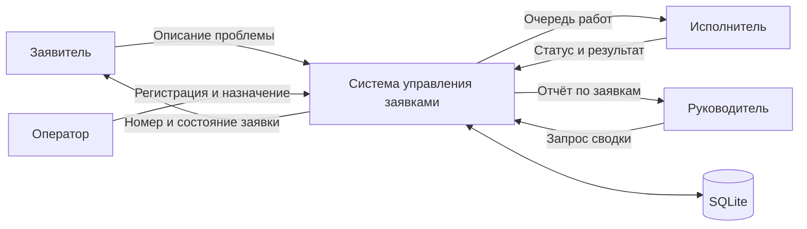
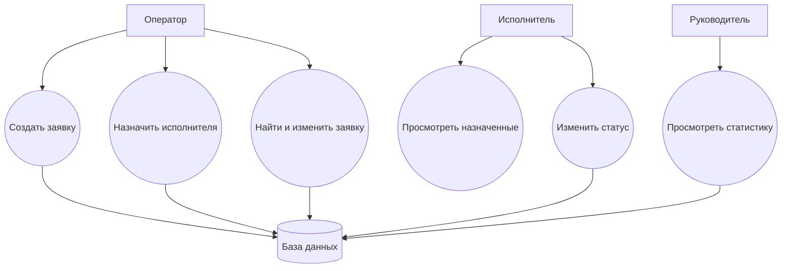

# УП.01 — Информационная система управления заявками

> Рабочий документ для подготовки учебной практики по специальности 09.02.07 «Информационные системы и программирование». Это основа проекта и отчёта, а не подтверждение фактически выполненных работ. Перед сдачей нужно сверить структуру с методичкой преподавателя, запустить код, сделать собственные скриншоты и заменить учебные примеры фактическими результатами.

## 1. Паспорт проекта

- **Тема:** информационная система управления заявками.
- **Тип решения:** консольное приложение на C# с реляционной базой SQLite.
- **Предметная область:** регистрация, назначение исполнителей, изменение статусов и контроль выполнения внутренних заявок.
- **Цель:** разработать простую информационную систему, обеспечивающую централизованный учёт заявок и получение сведений об их состоянии.
- **Объект исследования:** процесс обработки заявок в организации.
- **Предмет исследования:** методы и программные средства регистрации, хранения, поиска и контроля заявок.
- **Пользователи:** оператор/диспетчер, исполнитель, руководитель. В минимальной консольной версии роли описываются в модели; полноценная авторизация может быть отдельным этапом.
- **Среда разработки:** .NET SDK, C#, SQLite, SQL; рекомендуемая IDE — Visual Studio или Rider.
- **Границы первой версии:** создание, просмотр, изменение, закрытие и поиск заявок; справочник категорий и исполнителей; отчётные запросы. Интеграции с почтой, SMS и внешними сервисами не входят в минимальную версию.

## 2. Анализ предметной области

Без единого реестра заявки могут поступать по телефону, электронной почте и устно. Это затрудняет поиск истории, контроль сроков, определение ответственного и подготовку сводки для руководителя. Информационная система должна хранить заявки в едином формате и предоставлять быстрый доступ к актуальному статусу.

### 2.1 Основные сущности

1. **Заявка** — тема, описание, дата создания, приоритет, статус, категория, автор и назначенный исполнитель.
2. **Пользователь** — имя, контактные данные и роль.
3. **Категория** — тип обращения, например «Оборудование», «Программное обеспечение», «Доступ».
4. **История статусов** — кто и когда изменил состояние заявки; позволяет восстановить последовательность обработки.

### 2.2 Роли и обязанности

| Роль | Основные действия |
|---|---|
| Оператор | Регистрирует обращения, уточняет данные, назначает исполнителя |
| Исполнитель | Просматривает назначенные заявки, меняет статус, добавляет результат |
| Руководитель | Просматривает все заявки и сводные показатели |

В первой консольной версии разграничение ролей может быть представлено на уровне сценариев использования; нельзя заявлять о реальной защите доступа, пока авторизация не реализована.

### 2.3 Типовой процесс

1. Пользователь сообщает о проблеме или потребности.
2. Оператор создаёт заявку и указывает категорию и приоритет.
3. Заявка получает статус «Новая».
4. Оператор назначает исполнителя; тот принимает работу.
5. Исполнитель выполняет работу и фиксирует результат.
6. Заявка переводится в «Решена», а после подтверждения — в «Закрыта».
7. Руководитель использует поиск и отчёты для контроля нагрузки и просроченных заявок.

## 3. Цель, задачи и ожидаемый результат

### Цель
Создать работоспособный прототип системы учёта заявок с постоянным хранением данных.

### Задачи
- изучить процесс обработки заявок и определить пользователей;
- сформулировать функциональные и нефункциональные требования;
- построить модель данных и определить связи сущностей;
- создать базу данных SQLite и ограничения целостности;
- разработать меню консольного приложения на C#;
- реализовать CRUD-операции, фильтрацию и отчётные запросы;
- проверить корректность сценариев и обработку ошибочного ввода;
- подготовить инструкцию пользователя и материалы демонстрации.

### Ожидаемый результат
Приложение позволяет регистрировать заявки, назначать исполнителей, отслеживать статусы, находить записи по параметрам и получать сводные данные. Результат подтверждается запуском приложения, тестовыми сценариями и скриншотами реального выполнения.

## 4. Требования к системе

### 4.1 Функциональные требования

- **FR-01:** создавать заявку с обязательной темой и описанием.
- **FR-02:** автоматически присваивать заявке уникальный идентификатор и время создания.
- **FR-03:** просматривать список заявок и карточку выбранной заявки.
- **FR-04:** редактировать тему, описание, категорию и приоритет.
- **FR-05:** назначать или менять исполнителя.
- **FR-06:** менять статус по допустимому сценарию.
- **FR-07:** искать заявки по идентификатору или части темы.
- **FR-08:** фильтровать заявки по статусу, приоритету и исполнителю.
- **FR-09:** показывать количество заявок по статусам и открытые заявки по приоритетам.
- **FR-10:** сохранять изменения в SQLite между запусками.
- **FR-11:** проверять ввод и сообщать об ошибках понятным текстом.
- **FR-12:** сохранять историю изменений статусов.

### 4.2 Нефункциональные требования

- целостность данных обеспечивается первичными/внешними ключами и ограничениями;
- SQL-команды выполняются с параметрами, а не конкатенацией пользовательского ввода;
- при ошибке пользователь получает сообщение, а приложение не должно аварийно завершаться из-за ожидаемой ошибки ввода;
- интерфейс меню должен быть понятным и не требовать знания SQL;
- код разделяется на слой работы с данными и пользовательское меню без чрезмерного усложнения архитектуры;
- данные хранятся локально в файле базы данных;
- производительность оценивается на тестовом наборе записей, размер которого фиксируется в отчёте.

### 4.3 Ограничения и допущения

Прототип предназначен для локального учебного использования. Сетевой многопользовательский режим, резервное копирование по расписанию, электронная почта и полноценная система прав не входят в минимальный объём. Сроки исполнения и нормативы SLA задаются организацией; если таких данных нет, в проекте не следует выдумывать реальные нормативы.

## 5. Моделирование

### 5.1 Контекст системы



### 5.2 Use Case



### 5.3 Основные правила

- новая заявка создаётся со статусом `New`;
- приоритет имеет одно из значений `Low`, `Normal`, `High`, `Critical`;
- статус имеет одно из значений `New`, `Assigned`, `InProgress`, `Resolved`, `Closed`, `Cancelled`;
- закрытая заявка не редактируется как активная работа; при необходимости повторного открытия применяется отдельное действие;
- назначенный исполнитель и категория должны существовать в справочниках;
- история статусов добавляется при каждом фактическом изменении статуса.

## 6. Проектирование базы данных

### 6.1 Логическая модель

- `Users` (1) — (N) `Requests` через поля автора и исполнителя.
- `Categories` (1) — (N) `Requests`.
- `Requests` (1) — (N) `RequestStatusHistory`.
- Внешний ключ исполнителя допускает `NULL`, пока заявка не назначена.

### 6.2 Физическая схема SQLite

Следующий SQL можно сохранить как `schema.sql` и выполнить в SQLite. Он создаёт структуру и стартовые справочные записи, но не заменяет проверку выполнения в выбранной среде.

```sql
PRAGMA foreign_keys = ON;

CREATE TABLE IF NOT EXISTS Users (
    Id          INTEGER PRIMARY KEY AUTOINCREMENT,
    FullName    TEXT NOT NULL CHECK (length(trim(FullName)) > 0),
    Email       TEXT UNIQUE,
    Role        TEXT NOT NULL CHECK (Role IN ('Operator', 'Executor', 'Manager')),
    IsActive    INTEGER NOT NULL DEFAULT 1 CHECK (IsActive IN (0, 1))
);

CREATE TABLE IF NOT EXISTS Categories (
    Id          INTEGER PRIMARY KEY AUTOINCREMENT,
    Name        TEXT NOT NULL UNIQUE CHECK (length(trim(Name)) > 0),
    Description TEXT
);

CREATE TABLE IF NOT EXISTS Requests (
    Id            INTEGER PRIMARY KEY AUTOINCREMENT,
    Title         TEXT NOT NULL CHECK (length(trim(Title)) > 0),
    Description   TEXT NOT NULL CHECK (length(trim(Description)) > 0),
    CategoryId    INTEGER NOT NULL,
    CreatedById   INTEGER NOT NULL,
    AssigneeId    INTEGER,
    Priority      TEXT NOT NULL DEFAULT 'Normal'
                  CHECK (Priority IN ('Low', 'Normal', 'High', 'Critical')),
    Status        TEXT NOT NULL DEFAULT 'New'
                  CHECK (Status IN ('New', 'Assigned', 'InProgress',
                                    'Resolved', 'Closed', 'Cancelled')),
    CreatedAt     TEXT NOT NULL DEFAULT (datetime('now')),
    UpdatedAt     TEXT NOT NULL DEFAULT (datetime('now')),
    ResolvedAt    TEXT,
    Resolution    TEXT,
    FOREIGN KEY (CategoryId) REFERENCES Categories(Id),
    FOREIGN KEY (CreatedById) REFERENCES Users(Id),
    FOREIGN KEY (AssigneeId) REFERENCES Users(Id)
);

CREATE TABLE IF NOT EXISTS RequestStatusHistory (
    Id          INTEGER PRIMARY KEY AUTOINCREMENT,
    RequestId   INTEGER NOT NULL,
    OldStatus   TEXT,
    NewStatus   TEXT NOT NULL,
    ChangedById INTEGER NOT NULL,
    ChangedAt   TEXT NOT NULL DEFAULT (datetime('now')),
    Comment     TEXT,
    FOREIGN KEY (RequestId) REFERENCES Requests(Id) ON DELETE CASCADE,
    FOREIGN KEY (ChangedById) REFERENCES Users(Id)
);

CREATE INDEX IF NOT EXISTS IX_Requests_Status ON Requests(Status);
CREATE INDEX IF NOT EXISTS IX_Requests_Priority ON Requests(Priority);
CREATE INDEX IF NOT EXISTS IX_Requests_Assignee ON Requests(AssigneeId);
CREATE INDEX IF NOT EXISTS IX_Requests_CreatedAt ON Requests(CreatedAt);
CREATE INDEX IF NOT EXISTS IX_History_RequestId ON RequestStatusHistory(RequestId);

INSERT OR IGNORE INTO Categories(Name, Description) VALUES
 ('Оборудование', 'Компьютеры и периферийные устройства'),
 ('Программное обеспечение', 'Ошибки и установка программ'),
 ('Доступ', 'Учётные записи и права доступа');

INSERT OR IGNORE INTO Users(FullName, Email, Role) VALUES
 ('Учебный оператор', 'operator@example.local', 'Operator'),
 ('Учебный исполнитель', 'executor@example.local', 'Executor'),
 ('Учебный руководитель', 'manager@example.local', 'Manager');
```

> Примечание: адреса `example.local` и учебные имена — тестовые данные, не реальные пользователи. Для воспроизводимости приложения нужно включать `PRAGMA foreign_keys = ON` при каждом соединении SQLite.

### 6.3 Примеры полезных запросов

**Список заявок с категорией и исполнителем:**
```sql
SELECT r.Id, r.Title, c.Name AS Category, r.Priority, r.Status,
       u.FullName AS Assignee, r.CreatedAt
FROM Requests r
JOIN Categories c ON c.Id = r.CategoryId
LEFT JOIN Users u ON u.Id = r.AssigneeId
ORDER BY
  CASE r.Priority
    WHEN 'Critical' THEN 1 WHEN 'High' THEN 2
    WHEN 'Normal' THEN 3 ELSE 4
  END,
  r.CreatedAt;
```

**Количество заявок по статусам:**
```sql
SELECT Status, COUNT(*) AS RequestCount
FROM Requests
GROUP BY Status
ORDER BY RequestCount DESC;
```

**Открытые заявки без назначенного исполнителя:**
```sql
SELECT Id, Title, Priority, CreatedAt
FROM Requests
WHERE AssigneeId IS NULL
  AND Status IN ('New', 'Assigned', 'InProgress')
ORDER BY CreatedAt;
```

**История конкретной заявки:**
```sql
SELECT h.OldStatus, h.NewStatus, h.ChangedAt, u.FullName, h.Comment
FROM RequestStatusHistory h
JOIN Users u ON u.Id = h.ChangedById
WHERE h.RequestId = @requestId
ORDER BY h.ChangedAt, h.Id;
```

**Поиск по части темы** (параметр обязателен):
```sql
SELECT Id, Title, Status, Priority
FROM Requests
WHERE Title LIKE @pattern
ORDER BY CreatedAt DESC;
```
Для параметра передаётся значение вида `%монитор%`; пользовательский ввод нельзя вставлять непосредственно в SQL-строку.

## 7. Реализация приложения на C#

### 7.1 Рекомендуемый минимальный стек

- .NET 8 или более новая доступная версия SDK;
- C#;
- SQLite через NuGet-пакет `Microsoft.Data.Sqlite`;
- консольное меню;
- SQL-схема из раздела 6.

Версию .NET необходимо согласовать с установленным SDK и требованиями учебной среды. В отчёте указывается фактически использованная версия.

### 7.2 Создание проекта

```powershell
dotnet new console -n RequestManagement
cd RequestManagement
dotnet add package Microsoft.Data.Sqlite
dotnet run
```

### 7.3 Предлагаемая структура

```text
RequestManagement/
├── RequestManagement.csproj
├── Program.cs              # меню и цикл приложения
├── Data/
│   ├── Database.cs         # соединение и инициализация схемы
│   └── RequestRepository.cs# параметризованные SQL-операции
├── Models/
│   ├── Request.cs
│   ├── User.cs
│   └── Category.cs
├── schema.sql
└── README.md
```

Для небольшой учебной работы допускается начать с одного `Program.cs`, но SQL-операции желательно вынести в отдельный класс. Не нужно создавать сложную многоуровневую архитектуру, если она не требуется методичкой.

### 7.4 Состав меню

```text
=== Система управления заявками ===
1. Показать все заявки
2. Создать заявку
3. Открыть карточку заявки
4. Изменить заявку
5. Назначить исполнителя
6. Изменить статус
7. Найти заявки
8. Отчёт по статусам
9. История статусов
0. Выход
Выберите действие:
```

### 7.5 Требования к реализации

- инициализировать файл БД и схему при первом запуске;
- использовать `using` для `SqliteConnection`, `SqliteCommand` и читателей;
- передавать пользовательские значения через параметры;
- проверять обязательные поля и числовые идентификаторы;
- при изменении статуса в одной транзакции обновлять `Requests` и добавлять строку в `RequestStatusHistory`;
- при назначении проверять существование и активность исполнителя;
- выводить пустые результаты как «Заявки не найдены», а не как исключение;
- не выводить пароли и не хранить реальные секреты в тестовых данных.

### 7.6 Алгоритм изменения статуса

1. Получить идентификатор заявки и новый статус.
2. Найти заявку; если она отсутствует, сообщить об этом.
3. Проверить допустимость перехода статуса.
4. Начать транзакцию.
5. Обновить статус и дату изменения.
6. Добавить запись истории с прежним и новым статусом, пользователем и комментарием.
7. Зафиксировать транзакцию; при ошибке выполнить откат.
8. Показать результат пользователю.

## 8. План тестирования

Тесты ниже — план проверки. Статус «пройден» можно поставить только после реального выполнения.

| ID | Сценарий | Ожидаемый результат | Факт |
|---|---|---|---|
| T-01 | Создание корректной заявки | Запись получает ID, статус New и дату | Заполнить после запуска |
| T-02 | Пустая тема | Валидация запрещает сохранение | Заполнить после запуска |
| T-03 | Просмотр пустого списка | Понятное сообщение без аварии | Заполнить после запуска |
| T-04 | Поиск существующей темы | Найдены соответствующие записи | Заполнить после запуска |
| T-05 | Поиск отсутствующей темы | Выведено «не найдено» | Заполнить после запуска |
| T-06 | Назначение существующего исполнителя | AssigneeId обновлён | Заполнить после запуска |
| T-07 | Назначение несуществующего ID | Операция отклонена | Заполнить после запуска |
| T-08 | Изменение статуса | Текущий статус обновлён | Заполнить после запуска |
| T-09 | Изменение статуса | В истории создана запись | Заполнить после запуска |
| T-10 | Перезапуск приложения | Ранее созданные данные сохранены | Заполнить после запуска |
| T-11 | SQL-строка в поисковом вводе | Ввод обрабатывается как параметр | Заполнить после запуска |
| T-12 | Удаление категории, используемой заявкой | Ссылочная целостность не нарушена | Заполнить после запуска |

### 8.1 Проверка результата

Для каждого сценария записать:
- исходные данные;
- шаги выполнения;
- ожидаемый результат;
- фактический результат;
- статус «пройден/не пройден»;
- номер скриншота или ссылку на журнал.

Не следует указывать, что все тесты пройдены, пока они не выполнены на рабочем приложении. При обнаружении ошибки записать её, исправление и повторный результат.

## 9. Руководство пользователя

1. Установить подходящий .NET SDK.
2. Открыть папку проекта в терминале.
3. Выполнить `dotnet restore`, затем `dotnet run`.
4. В меню выбрать «Создать заявку», заполнить тему, описание, категорию и приоритет.
5. Записать идентификатор созданной заявки.
6. Через просмотр или поиск найти заявку и назначить исполнителя.
7. После начала работ изменить статус на «InProgress».
8. После выполнения зафиксировать результат и перевести заявку в «Resolved», затем при необходимости — в «Closed».
9. Для контроля открыть отчёт по статусам и историю заявки.
10. Для завершения выбрать пункт «Выход». Данные сохраняются в локальной SQLite-базе.

Названия пунктов должны совпадать с фактическим интерфейсом готовой программы.

## 10. План отчёта по практике

Ориентировочная структура; точные требования к титульному листу, объёму и приложениям нужно брать из методички учебного заведения.

1. Титульный лист.
2. Содержание.
3. Введение: актуальность, цель и задачи.
4. Характеристика предметной области.
5. Анализ существующего процесса и проблем.
6. Пользователи и сценарии использования.
7. Требования к информационной системе.
8. Выбор технологий и обоснование SQLite/C#.
9. Проектирование архитектуры и алгоритмов.
10. Проектирование базы данных: ER-модель, таблицы, ключи, ограничения.
11. Реализация схемы SQL и тестовых справочников.
12. Реализация пользовательского интерфейса.
13. Реализация операций с данными, поиска и отчётов.
14. Тестирование: методика, таблица результатов, найденные ошибки.
15. Руководство пользователя.
16. Заключение.
17. Список использованных источников.
18. Приложения: листинги, SQL-сценарий, дополнительные скриншоты.

Чтобы обосновать объём отчёта, следует подробно описать реально выполненные проектные решения и результаты, а не искусственно увеличивать текст повторениями. Скриншоты должны быть получены из работающего приложения и иметь подписи.

## 11. План презентации

Рекомендуется 8 слайдов:

1. **Титульный:** тема, ФИО, группа, учебное заведение, руководитель.
2. **Проблема и актуальность:** почему нужен централизованный учёт заявок.
3. **Цель и задачи:** что требовалось реализовать.
4. **Предметная область:** роли и схема процесса.
5. **Проектирование:** ER-модель и основные таблицы.
6. **Реализация:** стек технологий, меню, ключевые функции.
7. **Тестирование:** фактические тесты, результаты и скриншоты.
8. **Итоги:** выполненные задачи, ограничения и возможное развитие.

Не размещать на слайдах большие фрагменты исходного кода. Использовать схемы и реальные скриншоты. Числа и результаты показывать только при наличии подтверждённых данных.

## 12. Подготовка к защите

Кратко объяснить:
- какую проблему решает система;
- почему выбраны C# и SQLite;
- какие сущности и связи представлены в базе;
- чем первичный ключ отличается от внешнего;
- зачем используются параметризованные запросы;
- как работает назначение исполнителя и изменение статуса;
- зачем нужна история статусов и транзакция;
- какие тесты были выполнены и какие ограничения остались.

### Возможные вопросы преподавателя

**Почему SQLite?** Для локального учебного прототипа она не требует отдельного сервера, хранит данные в файле и поддерживается библиотекой для C#.

**Зачем таблица истории?** Она сохраняет последовательность переходов статусов, время и инициатора изменения, в отличие от одного текущего значения в заявке.

**Как защищён поиск от SQL-инъекции?** Значения передаются SQL-параметрами; пользовательский текст не конкатенируется в SQL-команду.

**Как обеспечить согласованность обновления и истории?** Изменение заявки и добавление истории выполняются в одной транзакции.

**Что можно улучшить?** Добавить графический интерфейс, полноценную авторизацию и права, вложения, уведомления, отчёты по срокам, экспорт CSV и резервное копирование.

## 13. Источники для оформления списка литературы

Перед сдачей проверьте актуальность редакций и оформите записи по стандарту, принятому в учебном заведении.

1. Microsoft Learn. Документация по языку программирования C#: https://learn.microsoft.com/dotnet/csharp/
2. Microsoft Learn. Руководство по .NET: https://learn.microsoft.com/dotnet/
3. Microsoft Learn. Пакет Microsoft.Data.Sqlite: https://learn.microsoft.com/dotnet/standard/data/sqlite/
4. SQLite. Официальная документация SQL: https://www.sqlite.org/docs.html
5. Методические указания по учебной практике УП.01, выданные учебным заведением (указать полное название, автора/организацию и год по фактическому экземпляру).

Ссылки и даты обращения необходимо проверить непосредственно перед сдачей. Не указывать источники, которые фактически не использовались.

## 14. Контрольный список перед сдачей

- [ ] Сверить каждый пункт с оригинальной методичкой и требованиями преподавателя.
- [ ] Создать проект и проверить сборку на целевой версии .NET.
- [ ] Выполнить SQL-схему на чистой базе SQLite.
- [ ] Реализовать все заявленные пункты меню.
- [ ] Пройти тесты и внести фактические результаты в таблицу.
- [ ] Проверить сохранение данных после перезапуска.
- [ ] Сделать реальные скриншоты приложения и базы данных.
- [ ] Подготовить отчёт и презентацию по требованиям учебного заведения.
- [ ] Проверить орфографию, подписи таблиц и рисунков, список источников.
- [ ] Убедиться, что описание соответствует фактически реализованному коду.

## 15. Журнал выполнения

| Дата | Выполненная работа | Подтверждение/комментарий |
|---|---|---|
| Заполнить | Анализ методички | Указать конкретные пункты |
| Заполнить | Проектирование базы | Схема и файл SQL |
| Заполнить | Реализация | Коммит/файлы проекта |
| Заполнить | Тестирование | Таблица фактических результатов |
| Заполнить | Отчёт и презентация | Финальные документы |
